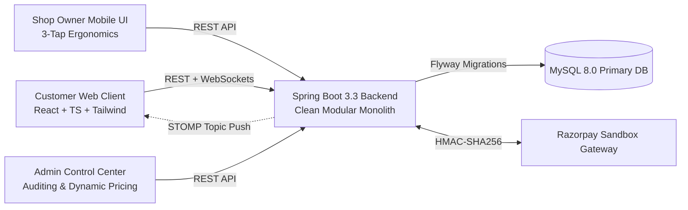

# LocalBite 🍲
### Production-Grade Hyper-Local Mini Shop Discovery & Live Food Availability Platform

[](https://opensource.org/licenses/Apache-2.0)
[](https://spring.io/projects/spring-boot)
[](https://react.dev/)
[](https://www.typescriptlang.org/)
[](https://tailwindcss.com/)
[](https://openjdk.org/)

LocalBite is an open-source, real-time discovery and availability platform designed specifically for the unorganized micro-eatery ecosystem: roadside tea stalls, small tiffin carts, snack shops, and chaat corners.

Unlike traditional delivery apps that charge steep commissions (20-35%) and require complex delivery fleets, LocalBite acts as an **informational & live visibility layer**. It empowers local roadside merchants to broadcast what food is hot and available in **under 5 seconds** from a smartphone, allowing customers to check availability before walking over.

---

## 🌟 Key Architecture & Capabilities

### 1. Vendor 3-Tap Mobile Inventory (<5 Seconds)
* Oversized, high-contrast touch targets ($54\times 54\text{ px}$) tailored for outdoor glare and fast-paced stall operations.
* Instant 3-state toggle: **`AVAILABLE`**, **`LIMITED`**, and **`SOLD_OUT`**.
* Immediate optimistic UI update backed by database transaction logging in `food_availability_history`.

### 2. Sub-500ms Real-Time Push via STOMP WebSockets
* Built on Spring WebSocket (`SimpMessagingTemplate`) over STOMP / SockJS.
* When a vendor marks an item as "Sold Out", all customers actively viewing that shop see the update instantly without page refreshes.

### 3. Dynamic Operating Hours & Midnight Crossing
* Mathematical time-interval computation handling daytime hours (e.g. 07:00 AM – 10:00 PM) as well as midnight-crossing overnight stalls (e.g. 08:00 PM – 02:00 AM).
* Automated checks for configured holidays and temporary emergency closures.

### 4. Enterprise RBAC & Security Perimeter
* **Stateless JWT Authentication** with BCrypt password hashing (cost factor 12).
* Role-based access control protecting Customer, Shop Owner, and Platform Administrator endpoints.
* Optimistic locking (`@Version`) preventing race conditions during concurrent menu updates.

### 5. Multi-Tier Monetization & Billing Engine
* Strict conceptual segregation between **One-Time Registration Fees** and **Recurring SaaS Subscriptions**.
* Integrated with **Razorpay Test Sandbox** with server-side order generation and HMAC-SHA256 cryptographic signature validation.
* 48-Hour subscription grace period before stall delisting.

---

## 🏗️ Architecture Overview



---

## 📁 Repository Structure

```
mini_bites/
├── backend/                             # Spring Boot 3.3.5 Backend (Java 21/25)
│   ├── src/main/java/com/localbite/
│   │   ├── auth/                        # User registration, login, JWT issuance
│   │   ├── shop/                        # Shop metadata, Haversine discovery, business hours
│   │   ├── food/                        # Food catalog, availability toggle, audit history
│   │   ├── realtime/                    # STOMP WebSocket broker & broadcast service
│   │   ├── payment/                     # Razorpay orders, HMAC-SHA256 verification, subscriptions
│   │   ├── admin/                       # Platform verification queue, pricing, audit logs
│   │   ├── user/                        # User JPA entity & repository
│   │   └── common/                      # Security filter, exceptions, response envelope
│   ├── src/main/resources/
│   │   ├── application.yml              # Profile-driven configuration
│   │   └── db/migration/                # Flyway SQL migrations (V1 3NF schema)
│   └── pom.xml                          # Maven build definition
├── frontend/                            # React 19 + TypeScript + Tailwind CSS Frontend
│   ├── src/
│   │   ├── components/                  # Navbar, Stall Cards, Status Badges
│   │   ├── context/                     # AuthContext (JWT persistence, RBAC)
│   │   ├── pages/                       # Home, Stall Detail, Login, Register
│   │   │   ├── owner/                   # Mobile-first Quick Dashboard, Billing
│   │   │   └── admin/                   # Verification queue, audit logs, analytics
│   │   ├── services/                    # Axios API client & STOMP WebSocket client
│   │   └── types/                       # Shared TypeScript models
│   ├── vite.config.ts                   # Vite configuration
│   └── package.json                     # Frontend dependencies
├── .env.example                         # Environment template
└── README.md
```

---

## 🚀 Getting Started

### Prerequisites
* **Java 21 LTS** or higher
* **Node.js v20+** and **npm v10+**
* **MySQL 8.0+** running locally on port 3306

### 1. Database Setup
Log in to your local MySQL server and create the database:
```sql
CREATE DATABASE localbite_db CHARACTER SET utf8mb4 COLLATE utf8mb4_unicode_ci;
```

### 2. Configure Environment Variables
Copy `.env.example` to `.env` and configure your credentials:
```bash
cp .env.example .env
```
Update your MySQL password in `backend/src/main/resources/application.yml` or set `DB_PASSWORD` in your terminal.

### 3. Run the Spring Boot Backend
```bash
cd backend
mvn spring-boot:run
```
The backend starts at `http://localhost:8080/api`. Flyway will automatically execute `V1__init_localbite_schema.sql`, creating all tables and default seed data.

### 4. Run the React Frontend
In a new terminal window:
```bash
cd frontend
npm install
npm run dev
```
The frontend starts at `http://localhost:5173`.

---

## 🧪 Running Automated Tests

Run backend unit and integration tests:
```bash
cd backend
mvn test
```

Build production client bundle:
```bash
cd frontend
npm run build
```

---

## 🛡️ Default Seed Credentials

For development and demonstration purposes, the database migration seeds a super administrator:

| Role | Email | Password |
| :--- | :--- | :--- |
| **Super Admin** | `admin@localbite.com` | `Admin@123` |

---

## 📄 License
This project is licensed under the Apache License 2.0 - see the [LICENSE](LICENSE) file for details.
